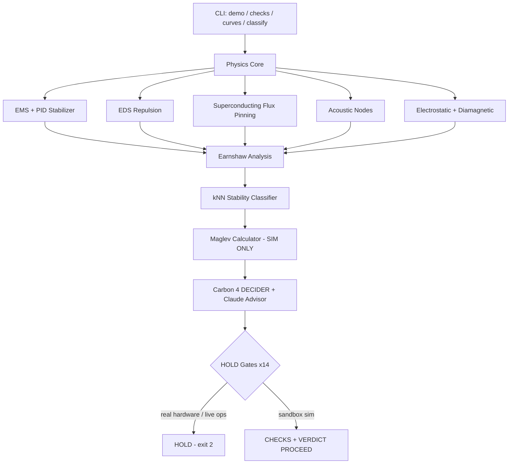
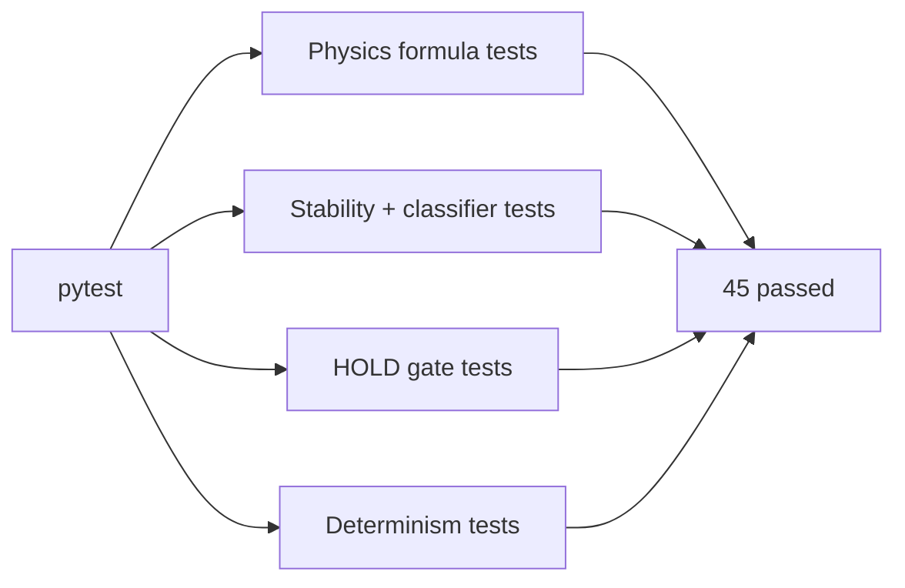
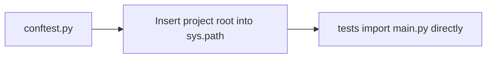
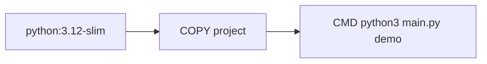

# LevitationX 🧲🛸

**Magnetic · Superconducting · Acoustic Levitation Lab** — by Darion Kellar

## ❓ What is this?

LevitationX is an **educational levitation physics lab** in ONE pure-Python file. It simulates every real way science can make an object float — magnetic attraction (EMS), magnetic repulsion (EDS), superconducting flux pinning, sound waves (acoustic), electric fields (electrostatic), and diamagnetism — using **real formulas**, then proves with numbers why some methods are stable, some need a computer controller, and why no static magnet trick can ever beat **Earnshaw's theorem**. ⚛️

It is a simulation and learning tool only. It controls **no hardware**, levitates **no person**, and makes **no anti-gravity claims** — every real-world operation sits behind a permanent HOLD gate (14 total). 🔒

## 🧰 Tech Stack Badges & Full Architecture


> ℹ️ Workflow badges are static **'Pending Paste'** shields on purpose: the `ci.yml` and `docker-publish.yml` files are delivered in the local paste pack and are **not pasted yet**, so no live badge is claimed.

**📦 1. Language & Runtime**
- 🐍 Python 3.12, pure standard library (`math`, `hashlib`, `json`, `sys`)
- 🚫 Zero dependencies, zero network, deterministic (double-run byte-identical)

**⚛️ 2. Physics Core**
- 🧲 EMS / EDS magnetics, superconducting flux pinning + Meissner screening
- 🔊 Acoustic radiation pressure, ⚡ electrostatic plates, 💎 diamagnetic gradient force
- 📐 Earnshaw stability analysis + force-vs-gap curves

**🤖 3. AI / ML**
- 🧠 TinyML kNN stability classifier (from scratch, stdlib)
- 🎛️ PID feedback stabilizer (feedback-linearized EMS control)
- 🔮 Gemini Carbon 4 DECIDER seat (names-only, tighten-only) + Muse advisor (never overrides HOLD)

**🎬 4. Media / Planning**
- 🎥 Google Flow plan-only seat (rendered = False, live = 0)

**🐳 5. Infrastructure**
- 🐳 Docker (`python:3.12-slim`), GitHub Actions CI + Docker Publish (paste pack)
- 🎯 Target image: `credkellar/levitationx:latest`

**🔒 6. Safety**
- ⛔ 14 HOLD gates — live vehicle control, human levitation, anti-gravity claims, real hardware, and more are permanently held

## 🔬 What this does

1. 🧲 **EMS magnetic levitation** — computes attractive force `F = μ₀N²AI²/(4g²)`, finds the equilibrium current for a mass, shows the stiffness is negative (unstable), proves an open-loop 1 mm offset runs away, then **stabilizes it with a PID controller** in simulation.
2. 🚄 **EDS magnetic levitation** — repulsive force that is zero at standstill and rises with speed; computes liftoff speed for a mass at a gap.
3. ❄️ **Superconducting levitation** — flux-pinning force vs gap, restoring stiffness, equilibrium gap for a mass, Meissner screening, and a materials table (YBCO, NbTi, Nb3Sn, MgB2, BSCCO) checked against Tc / Bc2. This is the **passively stable** method.
4. 🔊 **Acoustic levitation** — SPL → pressure, standing-wave node spacing (λ/2), nodes per cavity, and the largest droplet mass a given SPL can hold.
5. ⚡ **Electrostatic levitation** — parallel-plate force and the voltage needed to hold a mass; Earnshaw says feedback is required.
6. 💎 **Diamagnetic levitation** — the field-gradient product `B·dB/dz` needed per material; reproduces the famous ~1,400 T²/m result for water (the levitated-frog experiment) and shows why pyrolytic graphite floats over hobby magnets.
7. 📐 **Earnshaw's theorem module** — the statement, the Laplace-equation reason, a numeric saddle-point demo, and the 5 known evasions.
8. 📈 **Force-vs-gap curves** — deterministic tables for all 6 methods.
9. 🏷️ **Stability classifier** — a from-scratch kNN labels each regime `stable` / `unstable` / `feedback-required` / `stable-with-feedback`.
10. 🚅 **Maglev vehicle calculator (SIM ONLY)** — lift force, per-bogie load, and levitation-power estimate for a 40-tonne vehicle; its live-operation gate returns HOLD.
11. 🧠 **Advisory seats + checks** — Carbon 4 DECIDER with sha256 trace, Muse advisor, Google Flow plan-only, and a built-in CHECKS suite (41 checks).

## 🗺️ How it works — diagram per script

### `main.py` — the whole lab



### `tests/test_main.py` — verification



### `conftest.py` — test path setup



### `Dockerfile` — container



## 🤩 Why is this cool?

1. 🧲 Six real levitation methods in ONE file, each with its actual physics formula.
2. 📐 It doesn't just state Earnshaw's theorem — it **proves it numerically** with a perturbation demo.
3. 🎛️ You watch an unstable magnet get rescued by a PID controller, live in numbers.
4. ❄️ Flux pinning is shown as the one passive method that is stable in every direction.
5. 🐸 It reproduces the famous levitated-frog number (~1,400 T²/m for water) from first principles.
6. 🔊 It tells you exactly how loud sound must be to float a water droplet — and how big that droplet can be.
7. 🏷️ A tiny from-scratch ML classifier learns the stability map of the whole field.
8. 📈 Force-vs-gap curves make the difference between attraction, repulsion, and pinning obvious at a glance.
9. 🔒 14 HOLD gates make the safety boundary part of the code, not a footnote.
10. 🎯 Deterministic end to end: run it twice, get byte-identical output — science you can diff.

## 🛠️ What problems this solves?

1. ❌ **Problem:** Levitation demos online mix real physics with anti-gravity hype. ✅ **Solution:** Every claim here is a formula with a test; anti-gravity claims are a HOLD gate.
2. ❌ **Problem:** Beginners think two strong magnets should just float stably. ✅ **Solution:** The Earnshaw module shows numerically why that can never work — and what does.
3. ❌ **Problem:** EMS instability is usually hand-waved. ✅ **Solution:** Negative stiffness is computed, open-loop runaway is simulated, and PID rescue is demonstrated.
4. ❌ **Problem:** Maglev types (EMS vs EDS) get confused constantly. ✅ **Solution:** Side-by-side models: attraction + feedback vs repulsion + speed, with a liftoff-speed solver.
5. ❌ **Problem:** Superconductor levitation looks like magic in videos. ✅ **Solution:** Flux-pinning force, stiffness, and equilibrium gap are calculated step by step.
6. ❌ **Problem:** Acoustic levitation setups are trial-and-error. ✅ **Solution:** Node spacing and max droplet mass are predicted from SPL and frequency first.
7. ❌ **Problem:** Nobody sizes electrostatic levitation honestly. ✅ **Solution:** The voltage-for-weight calculator shows exactly why it stays a lab curiosity.
8. ❌ **Problem:** Diamagnetic levitation seems impossible until you see the gradient math. ✅ **Solution:** Per-material `B·dB/dz` requirements, from graphite to water.
9. ❌ **Problem:** Physics code usually needs numpy / scipy installs. ✅ **Solution:** Pure standard library — it runs anywhere Python 3.12 runs, including in Docker with zero pip installs.
10. ❌ **Problem:** Simulation tools quietly imply they can drive real hardware. ✅ **Solution:** 14 named HOLD gates return exit code 2 for every live operation, forever.

## 📥 How to install step-by-step

1. 📋 Clone or download this project folder.
2. 🐍 Make sure Python 3.12+ is installed: `python3 --version`
3. ▶️ Run the full demo + checks (no arguments needed):

```bash
python3 main.py
```

4. 🧪 Run the test suite:

```bash
pip install pytest
python3 -m pytest -q
```

5. 🎛️ Try the other commands:

```bash
python3 main.py checks      # 41 built-in checks
python3 main.py curves      # force-vs-gap tables for all 6 methods
python3 main.py classify    # kNN stability report
python3 main.py earnshaw    # Earnshaw demo + evasions
python3 main.py maglev      # maglev vehicle calculator (SIM ONLY)
python3 main.py brains      # Carbon 4 + Muse + Flow seats
python3 main.py holds       # list all 14 HOLD gates
python3 main.py hold-demo   # exits 2 - gated actions stay HOLD
```

6. 🐳 Or run it in Docker:

```bash
docker build -t credkellar/levitationx:latest .
docker run --rm credkellar/levitationx:latest
```

## 📋 Requirements

- 🐍 Python 3.12 or newer
- 📦 Dependencies: **none** (standard library only)
- 🌐 Network: **none** — fully offline
- 🧪 For tests only: `pytest`
- 🐳 Optional: Docker

## 🧒 5th-grade English section

Some things can float without touching anything! 🛸

- One way uses **magnets that pull**. But pulling magnets are wobbly — if the thing gets a tiny bit closer, the magnet pulls it even harder and it crashes. A fast computer brain has to keep fixing it, many times every second. That brain is called a **PID controller**. 🎛️
- Another way uses **magnets that push**, but they only push when you are already moving fast, like a maglev train. 🚄
- The coolest way uses a **super-cold superconductor**. It grabs the magnet's invisible field lines and holds them like tiny springs. It is steady all by itself! ❄️
- You can also float tiny drops of water with **very loud sound** that your ears can't even hear. The sound makes invisible shelves in the air, and the drops sit on them. 🔊
- A very strong magnet can even float a piece of special carbon, and scientists once floated a tiny frog! 🐸
- One rule says a plain magnet trick can **never** float steadily by itself. That rule is called **Earnshaw's theorem**, and this project shows you the math that proves it. 📐
- This project is a **pretend lab on a computer**. It does not float real people or real trains. It helps you learn how floating really works. 💻

## 🌳 Full file tree

```text
levitationx/
├── main.py                  # the whole lab: 6 methods, Earnshaw, PID, kNN, maglev, seats, HOLD gates
├── conftest.py              # puts the project root on sys.path for tests
├── tests/
│   └── test_main.py         # 45 pytest tests: formulas, stability, gates, determinism
├── assets/
│   └── cover.png            # README cover image (2736 x 912)
├── Dockerfile               # python:3.12-slim, runs the demo
└── README.md                # this file
```

> 📦 Delivered separately as paste packs (not in this tree): `.github/workflows/ci.yml` + `docker-publish.yml`, and the Docker Hub pack (100-char description, 350-char About, overview, categories).

---

MIT © 2026 Darion Kellar · LevitationX — educational simulation only 🧲
